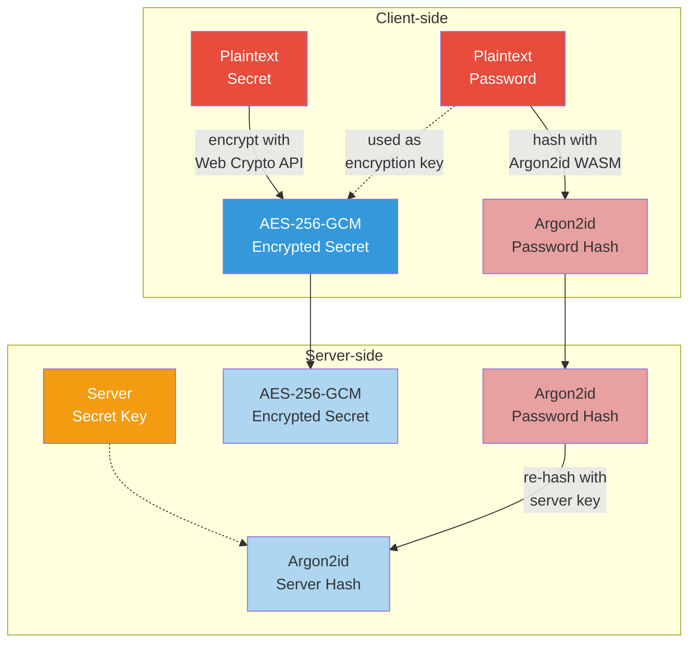

# [Whisper](https://github.com/viyh/whisper)

Secure secret sharing via one-time or short-lived links.

Share passwords, credentials, keys, or other sensitive data without using insecure channels like email or chat. Secrets are encrypted client-side before transmission -- the server never sees plaintext.

### Architecture



## How It Works

1. Enter secret text or select a file, along with a password.
2. Choose an expiration: one-time use, 1 hour, 1 day, or 1 week.
3. Click **Create Secret** to get a shareable link.
4. Send the link and password separately (e.g., link via email, password via text).
5. The recipient opens the link, enters the password, and retrieves the secret.

## Security Model

Whisper uses a layered security approach:

- **Client-side encryption**: Secrets are encrypted with AES-256-GCM (Web Crypto API) before leaving the browser. The server never has access to plaintext data.
- **Argon2id password hashing**: Passwords are hashed client-side using Argon2id (WASM) before transmission. The server re-hashes with its own Argon2id salt, so even a compromised server cannot recover passwords.
- **One-time secrets**: Deleted atomically after retrieval -- concurrent requests cannot both succeed.
- **Rate limiting**: 10 attempts per minute per IP, plus per-secret lockout after 10 failed password attempts.
- **Strict CSP**: No inline scripts. Content-Security-Policy with explicit allowlists.

See [Security Details](#security-details) for the full cryptographic design.

## Quick Start

```bash
# Generate a config file
cp src/config.default.yaml config.yaml

# Set a strong secret key
SECRET_KEY=$(head /dev/urandom | LC_ALL=C tr -dc 'A-Za-z0-9' | head -c 48)
# Edit config.yaml and set secret_key to the value above

# Build and run
docker build -t whisper .
docker run -d --name whisper -p 8000:8000 \
    -v $(pwd)/config.yaml:/usr/src/app/config.yaml \
    whisper
```

Browse to http://localhost:8000

## Configuration

Copy `src/config.default.yaml` to `config.yaml` and customize. Mount it into the container at `/usr/src/app/config.yaml`.

### Required Settings

| Setting | Description |
|---------|-------------|
| `secret_key` | Server-level secret for password hashing. Must be a unique random string of 32+ characters. **Change this from the default.** |
| `storage_class` | Storage backend class path (see [Storage Backends](#storage-backends)). |

### Optional Settings

| Setting | Default | Description |
|---------|---------|-------------|
| `storage_config` | `{}` | Backend-specific settings (bucket name, path, etc.) |
| `storage_clean_interval` | `900` | Seconds between expired secret cleanup runs. |
| `max_data_size_kb` | `100` | Maximum upload size in KB. |
| `app_listen_ip` | `0.0.0.0` | Internal listen address. |
| `app_port` | `5000` | Internal Flask port (nginx proxies externally). |
| `app_url_base` | `/` | URL base path (e.g., `/whisper/` for subpath hosting). |
| `argon2_time_cost` | `5` | Argon2id time cost parameter. Higher = slower + more secure. |
| `argon2_memory_cost` | `131072` | Argon2id memory cost in KB (131072 = 128 MB). |
| `argon2_parallelism` | `1` | Argon2id parallelism parameter. |

### Environment Variables

| Variable | Default | Description |
|----------|---------|-------------|
| `WEB_PORT` | `8000` | External nginx listen port. |
| `LOG_LEVEL` | `INFO` | Set to `DEBUG` for verbose logging. |
| `CONFIG_FILE` | `config.yaml` | Config file path inside the container. |

## Storage Backends

### Local Disk (default)

Stores secrets as JSON files. Mount a volume for persistence.

```yaml
storage_class: whisper.storage.local.local
storage_config:
    path: /tmp/whisper
```

```bash
docker run -d --name whisper -p 8000:8000 \
    -v $(pwd)/config.yaml:/usr/src/app/config.yaml \
    -v whisper-data:/tmp/whisper \
    whisper
```

### In-Memory

Simplest and most secure -- secrets are lost on restart.

```yaml
storage_class: whisper.storage.memory.memory
storage_config: {}
```

### AWS S3

Uses S3 object tags (`create_date`, `expire_date`) so the cleanup process only reads tags, not full objects.

```yaml
storage_class: whisper.storage.aws.s3
storage_config:
    bucket_name: my-whisper-bucket
    bucket_path: secrets
```

**Credentials**: IAM role (recommended), credential file mount (`-v ~/.aws:/.aws:ro`), or environment variables (`AWS_ACCESS_KEY_ID`, `AWS_SECRET_ACCESS_KEY`, `AWS_DEFAULT_REGION`).

**Minimum IAM permissions**:

```json
{
    "Version": "2012-10-17",
    "Statement": [{
        "Effect": "Allow",
        "Action": [
            "s3:ListBucket", "s3:GetBucketLocation",
            "s3:GetObject", "s3:PutObject", "s3:DeleteObject",
            "s3:GetObjectTagging", "s3:PutObjectTagging", "s3:DeleteObjectTagging"
        ],
        "Resource": [
            "arn:aws:s3:::my-whisper-bucket",
            "arn:aws:s3:::my-whisper-bucket/*"
        ]
    }]
}
```

### GCP Cloud Storage

Uses object metadata (`create_date`, `expire_date`) for efficient cleanup.

```yaml
storage_class: whisper.storage.gcp.gcs
storage_config:
    gcp_project: my-project
    bucket_name: my-whisper-bucket
    bucket_path: secrets
```

**Credentials**: Application default credentials (recommended), or mount gcloud config (`-v ~/.config/gcloud:/.config/gcloud:ro`).

**Required GCS permissions**:

```
storage.objects.get, storage.objects.update, storage.objects.list,
storage.objects.create, storage.objects.delete,
storage.multipartUploads.create, storage.multipartUploads.abort,
storage.multipartUploads.listParts, storage.multipartUploads.list,
storage.buckets.get
```

Or use built-in roles: `roles/storage.legacyObjectOwner` + `roles/storage.legacyBucketWriter`.

## Security Details

### Secret Structure

```json
{
    "id": "8d692508856cabba82d73e15ef6f0364de70546c",
    "create_date": 1657421435,
    "expire_date": -1,
    "data": "U2FsdGVkX1/qMytBOYisCGZ3KjpkowinHQhu12lGY8E=",
    "hash": "$argon2id$v=19$m=131072,t=5,p=1$...",
    "version": 2
}
```

| Field | Description |
|-------|-------------|
| `id` | 160-bit random hex identifier (40 chars). |
| `create_date` | UNIX timestamp of creation. |
| `expire_date` | UNIX timestamp of expiration, or `-1` for one-time use. |
| `data` | Client-encrypted ciphertext (AES-256-GCM for v2, AES-CBC for v1). |
| `hash` | Server-side password hash (Argon2id for v2, bcrypt for v1). |
| `version` | Crypto version: `1` = legacy, `2` = current. |

### Cryptographic Flow (v2)

**Creating a secret:**
1. User enters plaintext + password.
2. Client hashes password with **Argon2id** (configurable params, public salt from URL origin).
3. Client encrypts plaintext with **AES-256-GCM** via Web Crypto API (random 96-bit IV, PBKDF2-derived key at 210,000 iterations).
4. Client sends encrypted data + Argon2id hash to server.
5. Server re-hashes with **Argon2id** using server `secret_key` as additional input.
6. Server stores encrypted data + server-side hash.

**Retrieving a secret:**
1. Client hashes password with Argon2id (same params).
2. Server verifies against stored hash.
3. For one-time secrets: atomic claim-and-delete before returning data.
4. Client decrypts with AES-256-GCM using original password.

The server **never** has access to the plaintext password or data.

### Backward Compatibility

Version 1 secrets (PBKDF2 + bcrypt + CryptoJS AES-CBC) are still supported for retrieval. The `version` field determines which crypto path to use. Old secrets expire naturally.

## Development

### Writing Storage Backends

Storage backends must subclass `store` and implement:

| Method | Description |
|--------|-------------|
| `start()` | Initialize the backend. |
| `get_secret(secret_id)` | Return secret object or `False`. |
| `set_secret(s)` | Save a secret object. |
| `delete_secret(secret_id)` | Delete a secret. |
| `claim_secret(secret_id)` | Atomically delete and return `True` if it existed (for one-time secrets). |
| `delete_expired()` | Iterate stored secrets and delete any where `is_expired()` returns `True`. |

See `src/whisper/storage/memory.py` for a minimal example.

### Running for Development

```bash
docker build -t whisper:dev .
docker run -it --rm --name whisper -p 8000:8000 \
    -e LOG_LEVEL=DEBUG \
    -v $(pwd)/src/config.yaml:/usr/src/app/config.yaml \
    whisper:dev
```

### Building

```bash
# Standard build
docker build -t whisper:0.2.0 .

# Cross-platform build
docker buildx build --platform=linux/amd64,linux/arm64 \
    -t whisper:0.2.0 .
```

### Tech Stack

**Backend**: Python 3.12, Flask 3.1, Gunicorn 23, Nginx (Debian Slim)

**Client-side crypto**: Web Crypto API (AES-256-GCM, PBKDF2), argon2-browser (WASM)

**Frontend**: Bootstrap 5.3, clipboard.js, vanilla JS (no jQuery)

**Storage**: Local disk, in-memory, AWS S3, GCP Cloud Storage

## Contributing

Pull requests are welcome on GitHub.

## Author

Joe Richards (GitHub: [@viyh](https://github.com/viyh))

## License

[MIT License](LICENSE.md)
