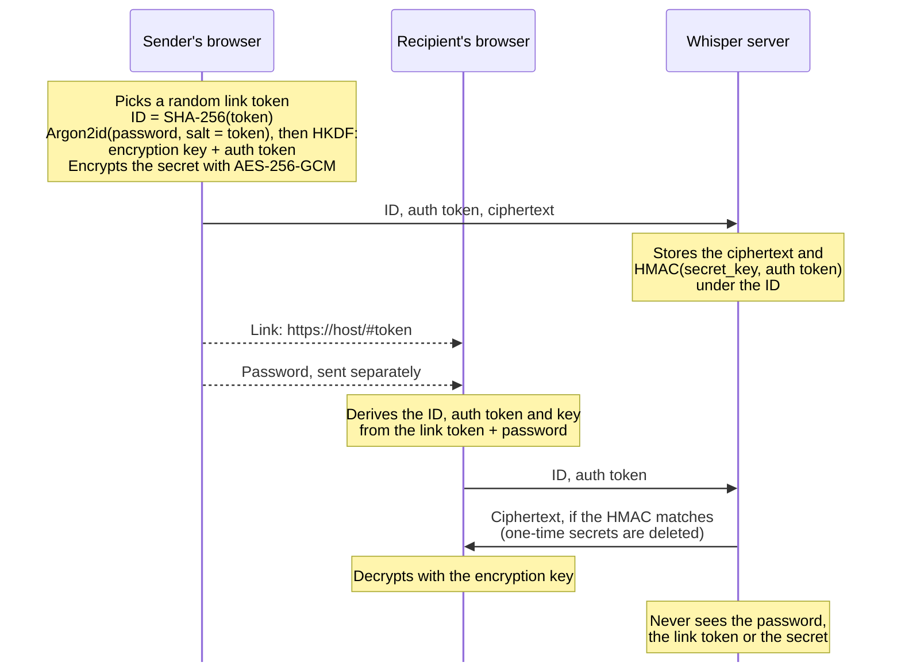

# [Whisper](https://github.com/viyh/whisper)

Secure secret sharing via one-time or short-lived links.

Share passwords, credentials, keys, or other sensitive data without using insecure channels like email or chat. Secrets are encrypted client-side before transmission -- the server never sees plaintext.

### Architecture



## How It Works

1. Enter secret text or select a file, along with a password.
2. Choose an expiration: one-time use, 1 hour, 1 day, or 1 week.
3. Click **Create Secret** to get a shareable link.
4. Send the link and password separately (e.g., link via email, password via text).
5. The recipient opens the link, enters the password, and retrieves the secret.

## Security Model

Whisper uses a layered security approach:

- **Client-side encryption**: Secrets are encrypted with AES-256-GCM (Web Crypto API) before leaving the browser. The server never has access to plaintext data or passwords.
- **The link and the password are both needed**: Each link ends in a random token after the `#`, which browsers never send to servers. The browser derives the encryption key from the password with Argon2id (WASM), salted with the token, and the server stores each secret under a hash of the token. The server, its storage and its logs can't decrypt a secret or tell which link it belongs to, and a copy of the storage is useless without the links, even with `secret_key`.
- **One-time secrets**: Deleted atomically after retrieval -- concurrent requests cannot both succeed. Unread one-time secrets are deleted after 30 days.
- **Rate limiting**: 10 attempts per minute per IP, plus a per-secret lock after 10 wrong passwords (`max_failed_attempts`). Behind a load balancer, set `trusted_proxy_count` (see [Running Behind a Proxy](#running-behind-a-proxy)).
- **Strict CSP**: No inline scripts or styles, and nothing is loaded from other sites.

See [Security Details](#security-details) for the full cryptographic design.

## Quick Start

```bash
# Generate a config file with a random secret key
export SECRET_KEY=$(head /dev/urandom | LC_ALL=C tr -dc 'A-Za-z0-9' | head -c 48)
sed "s/CHANGE_ME_TO_A_RANDOM_STRING_OF_32_OR_MORE_CHARACTERS/$SECRET_KEY/" src/config.default.yaml > config.yaml

# Build from source (optional, can also pull viyh/whisper:0.3.2).
# The base images need a free Docker account: docker login dhi.io
# docker build -t viyh/whisper .

# Run
docker run -d --name whisper -p 8000:8000 \
    -v $(pwd)/config.yaml:/usr/src/app/config.yaml \
    viyh/whisper:0.3.2
```

Browse to http://localhost:8000

For anything beyond local testing, Whisper must run behind a TLS-terminating proxy (a cloud load balancer, Cloud Run, Caddy, Traefik, ...). See [Deploying](#deploying).

## Configuration

Copy `src/config.default.yaml` to `config.yaml` and customize. Mount it into the container at `/usr/src/app/config.yaml`.

### Required Settings

| Setting | Description |
|---------|-------------|
| `secret_key` | Server secret that keys the stored HMAC of each secret's auth token (see [Cryptographic Flow](#cryptographic-flow-v3)). Must be a unique random string of 32+ characters. **Change this from the default.** |
| `storage_class` | Storage backend class path (see [Storage Backends](#storage-backends)). |

### Optional Settings

| Setting | Default | Description |
|---------|---------|-------------|
| `storage_config` | `{}` | Backend-specific settings (bucket name, path, etc.) |
| `storage_clean_interval` | `900` | Seconds between expired secret cleanup runs. |
| `max_data_size_kb` | `100` | Maximum upload size in KB. |
| `app_listen_ip` | `0.0.0.0` | Listen address for the development server (`python app.py`) only. |
| `app_port` | `5000` | Port for the development server only. In the container, see `WEB_PORT`. |
| `app_url_base` | `/` | URL base path (e.g., `/whisper/` for subpath hosting). |
| `argon2_time_cost` | `5` | Argon2id time cost for the key derivation, which runs in the browser. Higher = slower to create and open secrets, and slower to guess passwords. Changing any Argon2id setting makes unexpired secrets unopenable. |
| `argon2_memory_cost` | `131072` | Argon2id memory cost in KB (131072 = 128 MB). |
| `argon2_parallelism` | `1` | Argon2id parallelism. |
| `max_failed_attempts` | `10` | Wrong passwords allowed per secret before it locks until it expires. `0` turns the lock off; the per-IP rate limit still applies. |
| `trusted_proxy_count` | `0` | Number of `X-Forwarded-For` entries added by proxies in front of the container. See [Running Behind a Proxy](#running-behind-a-proxy). |

### Environment Variables

| Variable | Default | Description |
|----------|---------|-------------|
| `WEB_PORT` | `8000` | Port the container listens on. |
| `WEB_THREADS` | `2` | Concurrent requests handled. |
| `LOG_LEVEL` | `INFO` | Set to `DEBUG` for verbose logging. |
| `CONFIG_FILE` | `config.yaml` | Config file path inside the container. |
| `WHISPER_CONFIG` | | The config YAML itself. If set, used instead of `CONFIG_FILE`. For platforms that inject secrets as environment variables (e.g. ECS). |

### Running Behind a Proxy

Whisper rate-limits and logs by client IP. Any load balancer or CDN in front of the container adds its own `X-Forwarded-For` entries, and Whisper needs to know how many to skip to find the real client. If this is too low, every visitor appears to come from the proxy and shares a single rate limit, so one client can block retrievals for everyone. If it is too high, clients can spoof their IP and dodge the limit.

| Deployment | `trusted_proxy_count` |
|------------|-----------------------|
| Clients connect directly to the container | `0` |
| One proxy that appends the client IP (e.g. AWS ALB, Caddy, Traefik, nginx) | `1` |
| Google Cloud Run (`*.run.app` URL or domain mapping) | `1` |
| Proxy that appends the client IP and its own IP (e.g. Google Cloud external Application Load Balancer) | `2` |

Proxy behavior varies, so verify after deploying: each request is logged as `[<ip>] ...`, and that IP should be your own public address, not a private or load balancer address. Also check that a request with a fake `X-Forwarded-For: 1.2.3.4` header is still logged with your real IP; if not, the value is too high.

## Deploying

Whisper needs HTTPS in front of it: the browser crypto APIs require a secure context, and responses set HSTS. The container runs gunicorn directly and should not be exposed to the internet without a proxy, which also protects it from slow clients.

- **[`examples/terraform/gcp`](examples/terraform/gcp)**: Cloud Run with a domain mapping, GCS storage, and the config in Secret Manager.
- **[`examples/terraform/aws`](examples/terraform/aws)**: ECS Fargate behind an ALB with an ACM certificate, S3 storage, and the config in Secrets Manager.
- **[`examples/docker-compose.yaml`](examples/docker-compose.yaml)**: a single host, to put behind your own reverse proxy.

Use the GCS or S3 backend on Cloud Run or ECS; local and in-memory storage lose secrets when the container restarts or is replaced. Keep one instance (or task), since rate limits are kept in memory per instance.

## Storage Backends

### Local Disk (default)

Stores secrets as JSON files. Mount a volume for persistence.

```yaml
storage_class: whisper.storage.local.local
storage_config:
    path: /tmp/whisper
```

```bash
docker run -d --name whisper -p 8000:8000 \
    -v $(pwd)/config.yaml:/usr/src/app/config.yaml \
    -v whisper-data:/tmp/whisper \
    whisper
```

### In-Memory

Simplest and most secure -- secrets are lost on restart.

```yaml
storage_class: whisper.storage.memory.memory
storage_config: {}
```

### AWS S3

Uses S3 object tags (`create_date`, `expire_date`) so the cleanup process only reads tags, not full objects.

```yaml
storage_class: whisper.storage.aws.s3
storage_config:
    bucket_name: my-whisper-bucket
    bucket_path: secrets
```

**Credentials**: IAM role (recommended), credential file mount (`-v ~/.aws:/.aws:ro`), or environment variables (`AWS_ACCESS_KEY_ID`, `AWS_SECRET_ACCESS_KEY`, `AWS_DEFAULT_REGION`).

**Minimum IAM permissions**:

```json
{
    "Version": "2012-10-17",
    "Statement": [{
        "Effect": "Allow",
        "Action": [
            "s3:ListBucket", "s3:GetBucketLocation",
            "s3:GetObject", "s3:PutObject", "s3:DeleteObject",
            "s3:GetObjectTagging", "s3:PutObjectTagging", "s3:DeleteObjectTagging"
        ],
        "Resource": [
            "arn:aws:s3:::my-whisper-bucket",
            "arn:aws:s3:::my-whisper-bucket/*"
        ]
    }]
}
```

### GCP Cloud Storage

Uses object metadata (`create_date`, `expire_date`) for efficient cleanup.

```yaml
storage_class: whisper.storage.gcp.gcs
storage_config:
    gcp_project: my-project
    bucket_name: my-whisper-bucket
    bucket_path: secrets
```

**Credentials**: Application default credentials (recommended), or mount gcloud config (`-v ~/.config/gcloud:/.config/gcloud:ro`).

**Required GCS permissions**:

```
storage.objects.get, storage.objects.update, storage.objects.list,
storage.objects.create, storage.objects.delete,
storage.multipartUploads.create, storage.multipartUploads.abort,
storage.multipartUploads.listParts, storage.multipartUploads.list,
storage.buckets.get
```

Or use built-in roles on the bucket: `roles/storage.objectUser` + `roles/storage.legacyBucketReader`.

Disable the bucket's soft delete policy and object versioning so deleted secrets are really gone.

## Security Details

### Secret Structure

```json
{
    "id": "ef61c74ad052f48f54d58eda0a5aeae3b90cd0d7ba7d25ce62b605ed6bfd59f1",
    "create_date": 1795075200,
    "expire_date": -1,
    "data": "Zwt3ihvb8Pe0oeBQHB8vjJZ4Y6yI+pn/36pZXoSuYFAA8S13B8XsnFL6YvqBaf4GaG0IRg==",
    "hash": "db8ad3a89de86ef3295c3cf50f4f915fa065e736fcc4d90849f1580268733099",
    "version": 3,
    "failed_attempts": 0
}
```

| Field | Description |
|-------|-------------|
| `id` | SHA-256 of the link token (64 hex characters). The token itself never reaches the server. |
| `create_date` | UNIX timestamp of creation. |
| `expire_date` | UNIX timestamp of expiration, or `-1` for one-time use. |
| `data` | Ciphertext from the browser: the 96-bit IV followed by the AES-256-GCM ciphertext, base64-encoded. |
| `hash` | HMAC-SHA256 of the auth token, keyed with `secret_key`. |
| `version` | Format version. Only `3` can be created or opened (see [Older Links](#older-links)). |
| `failed_attempts` | Wrong passwords so far (see `max_failed_attempts`). |

### Cryptographic Flow (v3)

**Creating a secret:**
1. The browser picks a random 22-character link token (base58, about 129 bits).
2. The secret ID is the SHA-256 of `"whisper v3 id:"` + token.
3. Argon2id(password, salt = token, with the configured cost) gives 256 bits, which HKDF-SHA256 splits into an AES-256-GCM key and a 256-bit auth token.
4. The browser encrypts the secret with AES-256-GCM, using a random 96-bit IV and the secret ID as additional data, which binds the ciphertext to its ID.
5. It sends the ID, the auth token and the ciphertext. The server stores the ciphertext and HMAC-SHA256(`secret_key`, auth token) under the ID, and never overwrites an existing ID.
6. The link is `https://<host>/#<token>`. Browsers don't send the part after `#` to servers.

**Opening a secret:**
1. The browser takes the token from the link and derives the ID, auth token and key from it and the password, as above.
2. It sends the ID and the auth token. The server compares HMACs in constant time, and counts wrong passwords toward `max_failed_attempts`.
3. For one-time secrets: atomic claim-and-delete before returning data.
4. The browser decrypts the secret and removes the token from the address bar and history.

The server **never** sees the plaintext, the password, or the link token. Someone with a copy of the storage and `secret_key` but not the link can't decrypt a secret or guess its password offline, since the token is the Argon2id salt.

### Older Links

Links made before 0.4.0 (`https://<host>/<40 hex characters>`) can't be opened by 0.4.0 or later; Whisper says so instead. Their stored secrets are deleted when they expire.

For pre-0.2.0 (v1) links, check out the [`release/0.1.0_to_0.2.0`](../../tree/release/0.1.0_to_0.2.0) branch, which retains v1 decryption support.

### Rate Limiting

The default in-memory rate limiter (`storage_uri="memory://"`) keeps state in the container's single gunicorn process. With multiple containers or instances, each one enforces limits independently. For shared rate-limit state across workers, configure a Redis backend via [flask-limiter](https://flask-limiter.readthedocs.io/).

## Development

### Writing Storage Backends

Storage backends must subclass `store` and implement:

| Method | Description |
|--------|-------------|
| `start()` | Initialize the backend. |
| `get_secret(secret_id)` | Return secret object or `False`. |
| `set_secret(s)` | Save a new secret. Never overwrite: atomically return `False` without writing if one with that ID exists (IDs come from the browser). |
| `delete_secret(secret_id)` | Delete a secret. |
| `update_secret(s)` | Save changes to an existing secret; return `False` without writing if it no longer exists (never recreates a claimed secret). |
| `claim_secret(secret_id)` | Atomically delete and return `True` if it existed (for one-time secrets). |
| `delete_expired()` | Iterate stored secrets and delete any where `is_expired()` returns `True`. |

See `src/whisper/storage/memory.py` for a minimal example.

### Running for Development

```bash
docker build -t whisper:dev .
docker run -it --rm --name whisper -p 8000:8000 \
    -e LOG_LEVEL=DEBUG \
    -v $(pwd)/src/config.yaml:/usr/src/app/config.yaml \
    whisper:dev
```

### Building

The image builds on [Docker Hardened Images](https://dhi.io), which are free but need a Docker account: run `docker login dhi.io` first. The runtime image has no shell or package manager.

```bash
# Standard build
docker build -t whisper:0.3.2 .

# Cross-platform build
docker buildx build --platform=linux/amd64,linux/arm64 \
    -t whisper:0.3.2 .
```

### Tech Stack

**Backend**: Python 3.14, Flask 3.1, Gunicorn 27 (Docker Hardened Images, Debian 13)

**Client-side crypto**: Web Crypto API (AES-256-GCM, HKDF, SHA-256), argon2-browser (WASM, served from the image; see `src/whisper/assets/vendor`)

**Frontend**: vanilla JS and CSS, no framework and no CDN (copy uses the browser Clipboard API)

**Storage**: Local disk, in-memory, AWS S3, GCP Cloud Storage

## Contributing

Pull requests are welcome. See [CONTRIBUTING.md](CONTRIBUTING.md) for setup
and guidelines. For security issues, see [SECURITY.md](SECURITY.md).

## Author

Joe Richards (GitHub: [@viyh](https://github.com/viyh))

## License

[MIT License](LICENSE.md)
